<div align="center">

# Mohamed Abdo — Portfolio & CMS

**A cinematic, bilingual (Arabic / English) portfolio with a complete content dashboard.**
Every page, section, project, list, menu, text, image and setting is edited, previewed, published and restored
from the dashboard, without touching code.

[](https://github.com/m77mdabdo/mohamed-abdo-portfolio/actions/workflows/ci.yml)


%20%2F%20EN%20(LTR)-49DDE4)

[Screenshots](#screenshots) · [Features](#features) · [Stack](#stack) · [Install](#install-local) ·
[Run](#run) · [Docs](#documentation) · [Security](#security) · [بالعربية](#بالعربية)

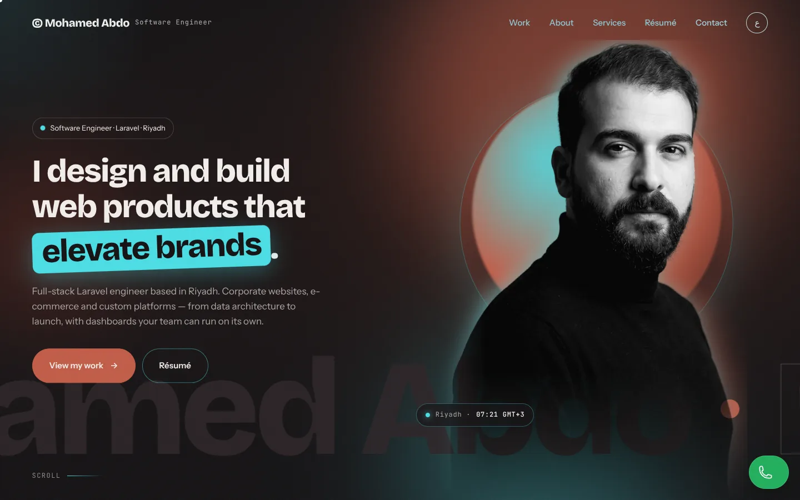

</div>

## Screenshots

All screenshots are taken from the running application with the original content imported by the seeder.

### Public site

| Arabic (RTL) | English (LTR) |
| --- | --- |
| 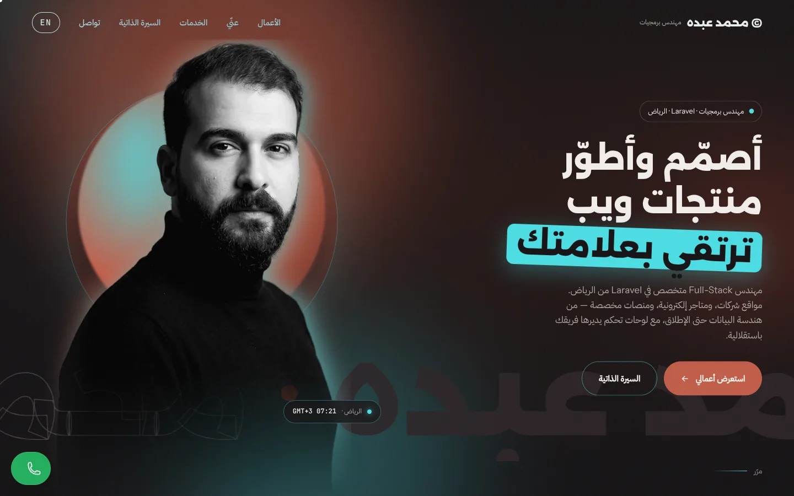 | 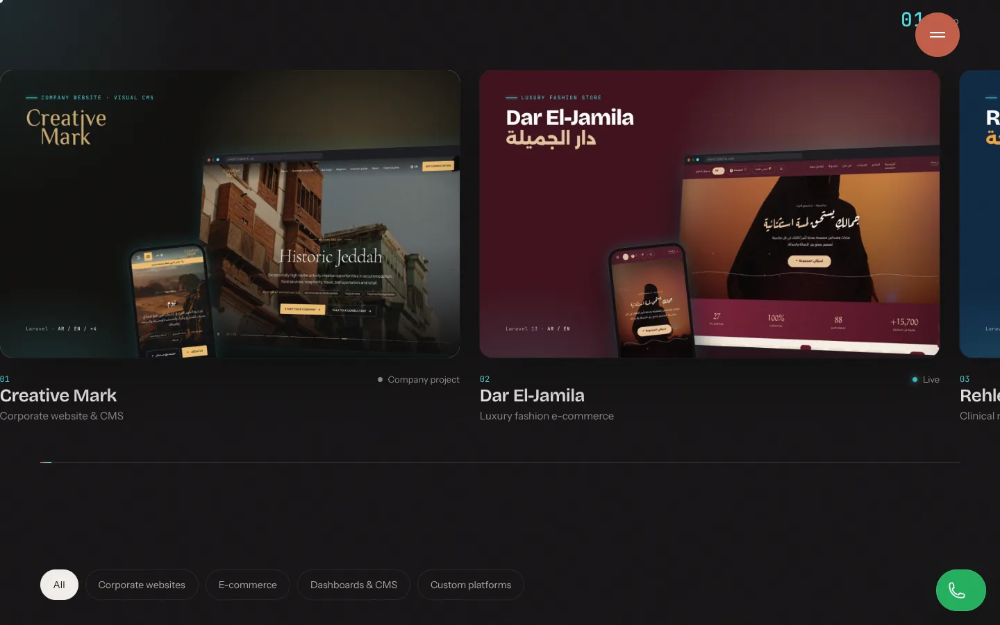 |
| 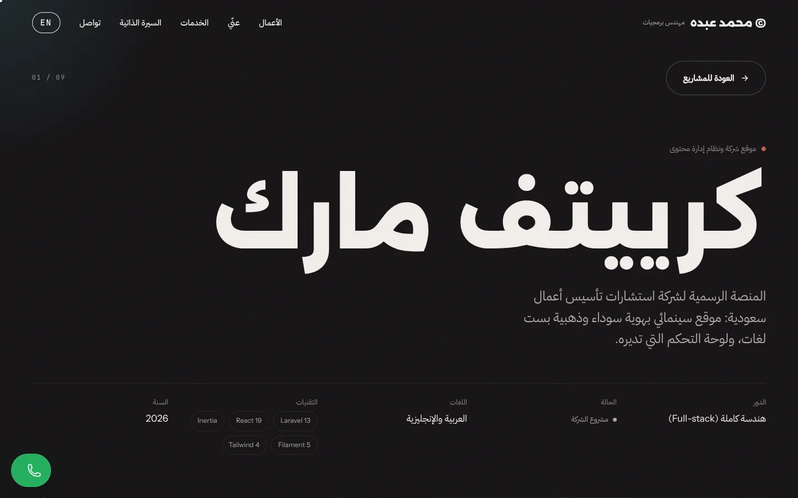 | 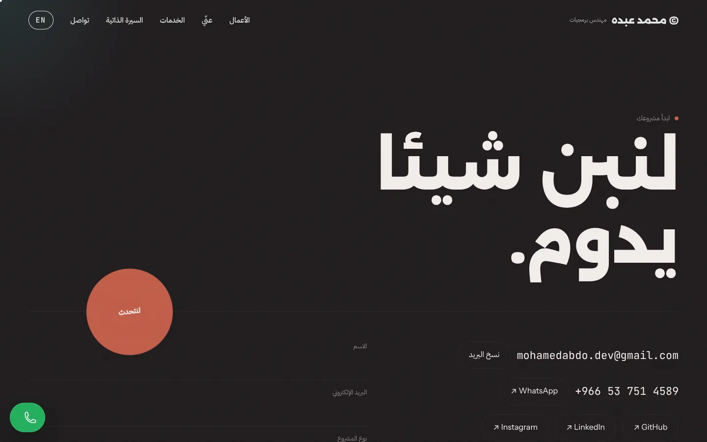 |

### Mobile

| Home (AR) | Home (EN) | Résumé (AR) | Project (EN) |
| --- | --- | --- | --- |
| 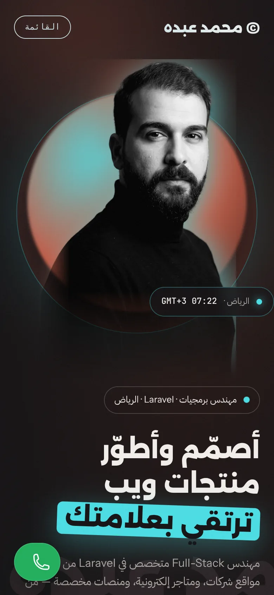 | 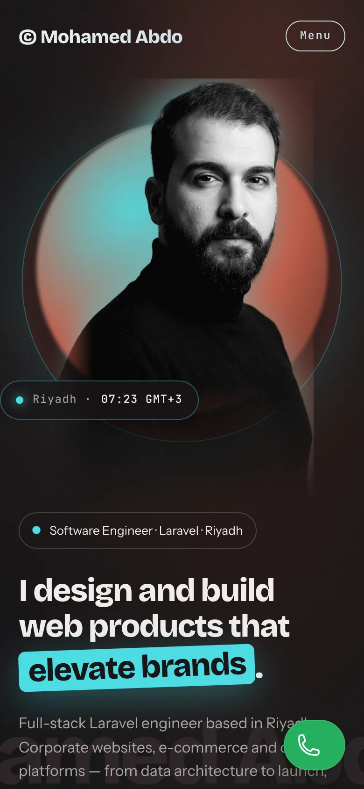 | 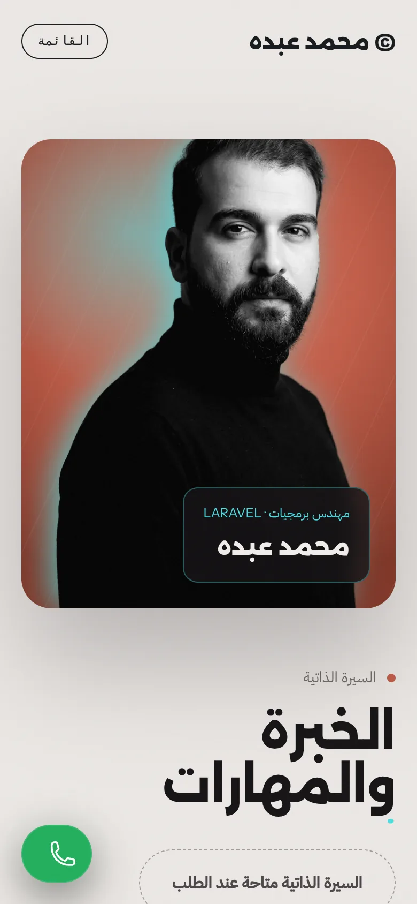 | 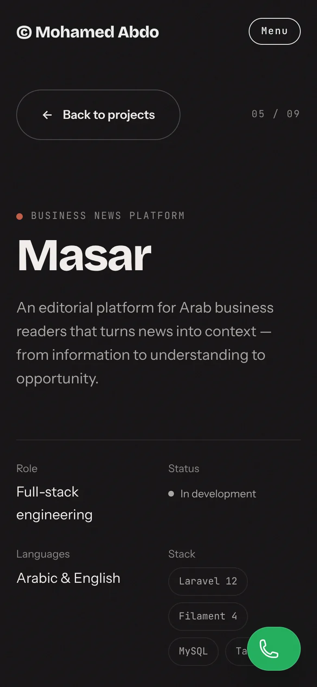 |

### Dashboard (`/admin`)

| Home page editor: sections in visible order (AR) | Pages |
| --- | --- |
| 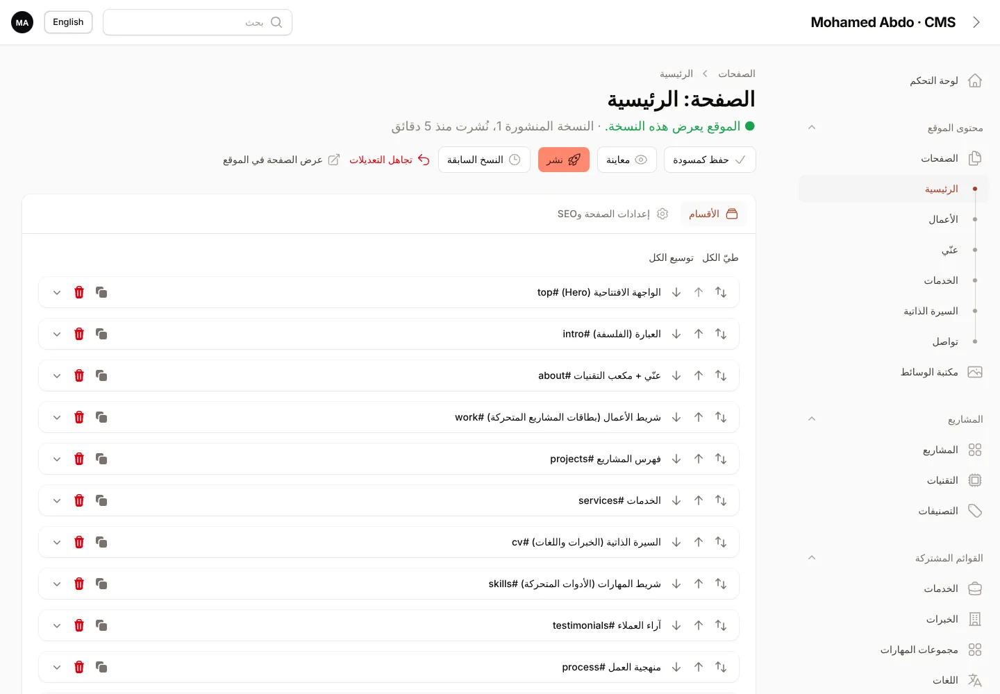 | 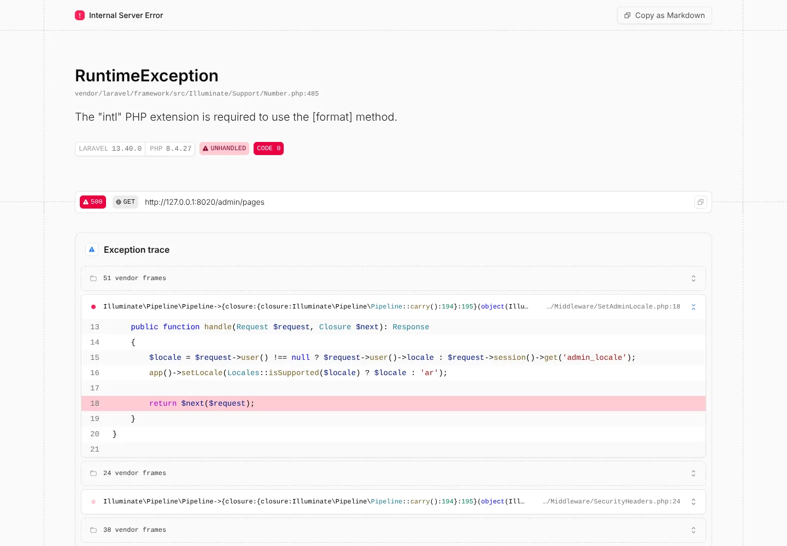 |
| **Project editor: draft, preview, publish, history** | **Appearance & motion settings** |
| 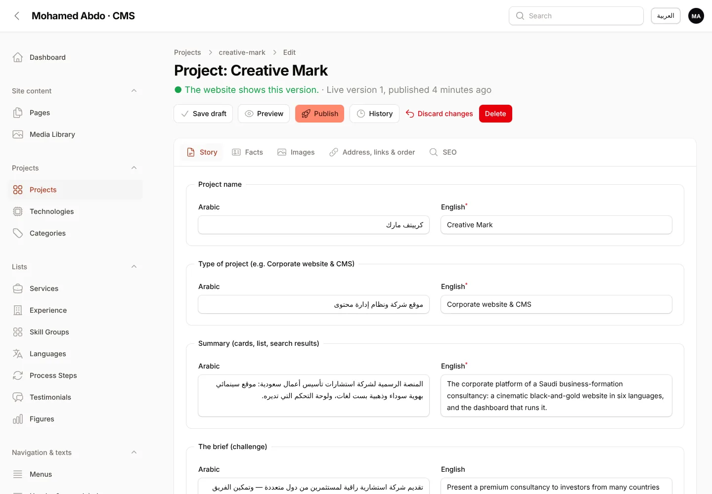 | 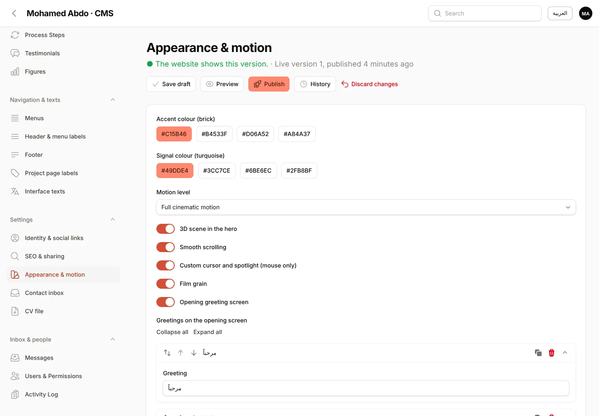 |

## Features

**Public site**

- Pages: cinematic one-page home plus standalone `/work`, `/about`, `/services`, `/resume`, `/contact` and
  `/projects/{slug}`, all under `/{ar|en}` with correct RTL / LTR layout and `hreflang`.
- Motion: GSAP timelines, Lenis smooth scrolling, a Three.js hero scene loaded on demand, a pinned project reel,
  a custom cursor and film grain. Every effect respects `prefers-reduced-motion`, has a fallback without WebGL,
  works with touch and keyboard, and cleans up its listeners and GPU resources on navigation.
- Complete HTML from Blade (readable without JavaScript), self-hosted fonts, responsive images, per-page SEO,
  Open Graph, sitemap.
- Contact form saved to the database first; the e-mail notice is a separate step, so a mail failure never loses
  a message. Floating WhatsApp / phone button and CV view and download.

**Dashboard (Filament 5, Arabic and English)**

- A clear editor for every public page under **Pages**. The home editor lists its sections in the order visitors
  see them; each section's texts, images, buttons, links, order and visibility are editable.
- Section library (17 ready-made section types) to add sections and new pages.
- Projects with galleries (desktop / mobile), technologies, categories and "next project" links; shared lists:
  services, experience, skill groups, languages, process steps, testimonials, figures.
- Header, footer, menus, interface texts, SEO, identity and social links, appearance and motion, CV file.
- **Drafts → signed preview → publish → history / restore.** Saving changes only the draft; the live site changes
  on Publish. Any previous version can be restored.
- Media library, contact inbox, users with owner / editor roles, activity log.
- Forms only: no JSON, HTML or JavaScript to write.

## Stack

Installed versions (see `composer.lock` / `package-lock.json`):

| Layer | Version |
| --- | --- |
| PHP | 8.4.1+ (developed on 8.5) |
| Laravel | 13.40 |
| Filament (dashboard) · Livewire | 5.11 · 4.4 |
| Database | MariaDB 10.4 (XAMPP), MySQL 8 compatible; SQLite for fast tests |
| Front end | Blade, TypeScript 5.9, Vite 8.3, GSAP 3.15, Three.js 0.169 (on demand), Lenis 1.3 |
| Fonts (self-hosted) | Bricolage Grotesque, Alexandria, Instrument Sans, IBM Plex Sans Arabic, JetBrains Mono (Fontsource) |
| Quality | PHPUnit 12, Larastan 3 (level 5), Pint, Playwright 1.64, GitHub Actions |

No React, Inertia, Redis or search engine: Blade renders the page and a small TypeScript runtime adds motion.
Design decisions are recorded in [docs/decisions.md](docs/decisions.md).

```text
app/Content/         section types, field schemas, publishing engine
app/Filament/        dashboard resources, pages and forms
app/Http/            public controllers, middleware (locale, security headers)
resources/views/     Blade layouts and section views
resources/ts/        motion runtime (GSAP, Lenis, Three.js)
database/            migrations, seeders (import of the original content)
scripts/             database setup, start, deploy, mail setup
tests/               Feature / Unit (PHPUnit), e2e (Playwright), perf (Web Vitals)
docs/                guides, database schema, decisions, verification
```

## Install (local)

Requirements: PHP 8.4.1+ with `mbstring`, `intl`, `gd`, `zip`, `exif`, `pdo_mysql`; Composer; Node 22; MariaDB
or MySQL.

```bash
git clone https://github.com/m77mdabdo/mohamed-abdo-portfolio.git
cd mohamed-abdo-portfolio
composer install
npm ci
cp .env.example .env && php artisan key:generate
bash scripts/create-database.sh            # XAMPP MariaDB: database, test database, two least-privilege users
php artisan migrate --database=mariadb_migrate
php artisan db:seed                          # imports the original content and images (safe to repeat)
php artisan storage:link
npm run build
php artisan portfolio:create-owner           # your sign-in; the password is typed, never stored in code
```

`scripts/create-database.sh` asks once for the MariaDB root password and writes generated passwords into `.env`
only. The runtime user (`map_app`) can only read and write data; schema changes use `map_migrate`.

## Run

Easiest: double-click **Start Portfolio.command** in the project folder (or `bash scripts/start.sh`). It uses
Homebrew PHP 8.4+, opens <http://127.0.0.1:8020/ar> and also runs the scheduler. XAMPP's Apache cannot run the
site (its PHP is 8.1); opening it through `localhost/mohamed-abdo-portfolio/public` shows these instructions.

Manually:

```bash
php artisan serve --host=127.0.0.1 --port=8020   # site: http://127.0.0.1:8020/ar · dashboard: /admin
php artisan queue:work --tries=3                 # optional: e-mail notices and image copies also run after each request
php artisan schedule:work                        # daily backup at 03:30 (Asia/Riyadh)
```

| URL | What |
| --- | --- |
| <http://127.0.0.1:8020/ar> · <http://127.0.0.1:8020/en> | public site |
| <http://127.0.0.1:8020/admin> | dashboard (sign-in + one-time code by e-mail) |

## Content workflow

Saving in the dashboard changes the **draft** only. **Preview** opens a signed 30-minute link (signed-in staff
only, `noindex`, `no-store`). **Publish** (owner) freezes the draft into an immutable version; **History**
restores any previous version into the draft, or straight to the live site. Deleting a page or project is
immediate (owner only). Details and a map of every visible element to its editor:
[owner guide (Arabic)](docs/owner-guide-ar.md).

## Commands

| Command | What it does |
| --- | --- |
| `composer test` | PHP tests on SQLite (in memory) |
| `composer test:mariadb` | the same tests on the separate MariaDB test database, plus backup / restore |
| `composer lint` | Pint (style) + Larastan (static analysis) |
| `npm run typecheck` / `npm run build` | TypeScript check / production assets |
| `BASE=http://127.0.0.1:8020 npx playwright test --trace off` | browser checks (server must be running) |
| `BASE=http://127.0.0.1:8020 node tests/perf/vitals.cjs` | lab Web Vitals (mobile emulation) |
| `php artisan db:seed` | re-run the content import (only adds what is missing) |
| `php artisan portfolio:create-owner` | create or reset the owner account |
| `bash scripts/configure-mail.sh` | set up Gmail / SMTP for sign-in codes and contact notices |
| `php artisan portfolio:mail-test [to]` | send a test e-mail with the current settings |
| `php artisan portfolio:backup [--no-media]` | database + uploads to `storage/app/private/backups` |
| `php artisan portfolio:restore <file>` | verify a backup in a temporary database (`--into-main` replaces live data) |
| `php artisan portfolio:preflight` | lists anything that still blocks going live |

## Backup and restore

Backups are private (`storage/app/private`, never served over HTTP), mode `0600`, rotated (14 kept), and run
daily from the scheduler.

- Uploaded files: `tar -xzf storage/app/private/backups/media-<stamp>.tar.gz -C storage/app/public`
- Database: `php artisan portfolio:restore <db-file>` first (checks it in a temporary database), then
  `php artisan portfolio:restore <db-file> --into-main` (asks you to type the database name).

## Deploy and CI

- CI: GitHub Actions runs PHP tests, Pint, Larastan, the TypeScript check, the front-end build and
  `composer audit` / `npm audit` on every push and pull request.
- Deployment over SSH exists but stays off until it is enabled ([docs/ci-cd.md](docs/ci-cd.md)).
- Manual deploy, step by step in Arabic: [docs/deploy-ar.md](docs/deploy-ar.md). In short: document root on
  `public/`, `.env` from `.env.production.example` (a real mailer is required, since sign-in codes are e-mailed),
  `bash scripts/deploy.sh`, and one cron entry `* * * * * php artisan schedule:run`.

## Security

- Dashboard behind sign-in with a one-time e-mail code at every sign-in; no public registration; rate-limited
  login; owner / editor policies on every model; 12-character password rule.
- CSRF on all forms; strict Content-Security-Policy with nonces on the public site and a baseline policy on the
  dashboard; escaped CMS text; URL allow-list for every link; the PHP version is not advertised.
- Uploads checked by real file type (no SVG / HTML / scripts, PDFs verified, images over 40 megapixels refused)
  and stored under random names.
- Contact form: validation, honeypot, rate limit, idempotent submissions.
- Secrets live only in `.env`, which is never committed. Audit: [docs/security-audit-2026-11.md](docs/security-audit-2026-11.md).

## Documentation

| Document | Contents |
| --- | --- |
| [docs/owner-guide-ar.md](docs/owner-guide-ar.md) | Arabic dashboard guide, and where each visible element is edited |
| [docs/database.md](docs/database.md) | database schema (ER diagram) and indexes |
| [docs/content-inventory.md](docs/content-inventory.md) | content imported from the original design |
| [docs/decisions.md](docs/decisions.md) | architecture and tooling decisions |
| [docs/verification.md](docs/verification.md) | what was tested and how |
| [docs/deploy-ar.md](docs/deploy-ar.md) · [docs/ci-cd.md](docs/ci-cd.md) | deployment and CI / CD |
| [docs/security-audit-2026-11.md](docs/security-audit-2026-11.md) | security audit and fixes |
| [docs/PROGRESS.md](docs/PROGRESS.md) | progress log |

## بالعربية

<div dir="rtl">

**موقع شخصي سينمائي لمحمد عبده بالعربية والإنجليزية، مع لوحة تحكم كاملة.**

- الموقع العام: الرئيسية وصفحات الأعمال وعنّي والخدمات والسيرة الذاتية والتواصل وصفحة لكل مشروع، باتجاه صحيح
  (RTL / LTR) وتصميم متجاوب وحركات GSAP وThree.js تحترم خيار تقليل الحركة.
- لوحة التحكم على `/admin`: لكل صفحة محرر واضح داخل «الصفحات»، والرئيسية تعرض أقسامها بنفس ترتيب ظهورها.
  تعديل النصوص والصور والأزرار والروابط والترتيب والإظهار والإخفاء، وإضافة صفحات وأقسام من مكتبة جاهزة،
  وإدارة المشاريع والقوائم والترجمات وSEO والمظهر والحركة، دون كتابة كود.
- المسودة لا تغيّر الموقع المنشور: حفظ ← معاينة محمية ← نشر ← استعادة أي نسخة سابقة.
- التشغيل المحلي: افتح **Start Portfolio.command** ثم ادخل على <http://127.0.0.1:8020/ar>، والدشبورد على
  <http://127.0.0.1:8020/admin>.
- دليل الإدارة الكامل بالعربية: [docs/owner-guide-ar.md](docs/owner-guide-ar.md)، ودليل النشر:
  [docs/deploy-ar.md](docs/deploy-ar.md).

</div>

## Third-party licences

Laravel, Filament, Livewire, Three.js, Lenis, Vite and the Fontsource packages: MIT. Fonts: SIL Open Font License.
GSAP: GreenSock Standard "no charge" licence (<https://gsap.com/standard-license>). Technology icons: simple-icons
(CC0); brand names and marks belong to their owners and are used only to name the tools.

## Changelog

- README with screenshots of the public site and dashboard (desktop and mobile, Arabic and English).
- Security hardening: the profile page enforces the 12-character password rule, the dashboard sends a baseline
  Content-Security-Policy, responses no longer reveal the PHP version. GitHub Actions CI (tests, lint, audit,
  build) and opt-in SSH deployment; `php artisan test` works on a fresh clone (`tests/Unit`).
- One-click start (Start Portfolio.command); images load on any local port; custom cursor no longer shows a stray
  "1"; clear page under old PHP.
- Full review pass: Arabic for the remaining dashboard labels and the Filament 5 strings its Arabic files lack
  (`lang/vendor/…`); the activity log names subjects in the reader's language; browser checks remove their test
  message from the local inbox. 40 public pages and 347 files checked: no broken links or images.
- Sign-in finishes with a one-time code e-mailed to the person (every account, 10 minutes, single use).
  Production readiness: `scripts/deploy.sh`, `.env.production.example`, `portfolio:preflight`, compression and
  browser caching in `public/.htaccess`, queued jobs from the cron entry, 3D scene skipped on software-only WebGL.
- Security audit ([docs/security-audit-2026-11.md](docs/security-audit-2026-11.md)): project folder refuses web
  requests, links in e-mails built from `APP_URL`, message notices fall back to the owner's address, images over
  40 megapixels refused.
- Code review (SOLID): stateless page / project controllers, project form and table in their own classes, shared
  bilingual field builder, tests for dashboard forms and image optimisation.
- Header links open standalone pages; floating WhatsApp button and phone (editable); CV view and download;
  e-mail notices without a background worker.
- Browser checks (6 widths × 2 languages, reduced motion, no WebGL, no JavaScript, keyboard), lab Web Vitals,
  font preloading.
- Dashboard: media library, inbox, users, activity log, publishing centre, Arabic translation; projects, shared
  lists, settings, menus, interface texts; page editor with sections library, drafts, signed preview, publish,
  history.
- Content model, publishing engine, section library, public site, SEO, import of the original content.
